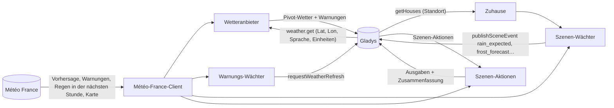
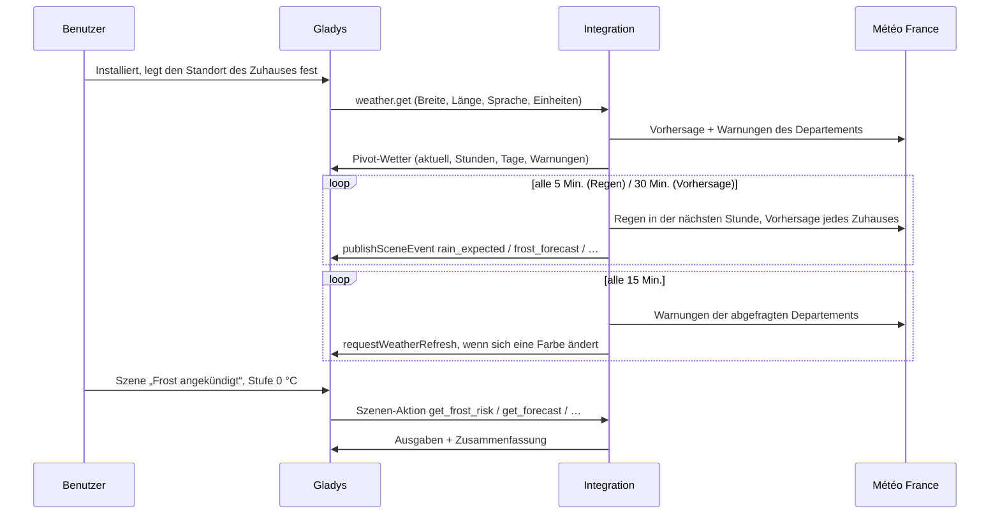
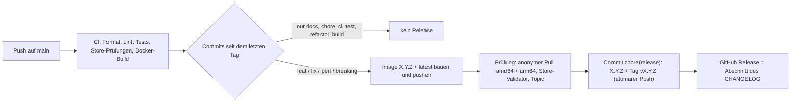

# Gladys Météo France

[English](README.md) · [Français](README.fr.md) · **Deutsch** · [Español](README.es.md)

[](LICENSE)
[](https://github.com/William-De71/gladys-meteo-france/releases)
[](https://github.com/William-De71/gladys-meteo-france/actions/workflows/release.yml)
[](https://gladysassistant.com)


Externe Integration für [Gladys Assistant](https://gladysassistant.com), die die Vorhersagen von **Météo France**,
die offiziellen **Unwetterwarnungen** (Vigilance) und wettergesteuerte **Szenen** für Zuhause in Frankreich
liefert, gebaut auf `@gladysassistant/integration-sdk` 0.15.

**Keine Konfiguration**: Vorhersagen, Warnungen und Szenen laufen über den öffentlichen Dienst der mobilen App von
Météo France. Installiere die Integration, und sie funktioniert; ein optionaler API-Schlüssel fügt nur die
nationale Warnkarte hinzu.

Benutzerdokumentation: [English](docs/en.md) · [Français](docs/fr.md) · [Deutsch](docs/de.md) ·
[Español](docs/es.md).

> Community-Integration, weder mit Météo France verbunden noch von Météo France unterstützt.

## Inhalt

- [Funktionen](#funktionen)
- [Architektur](#architektur)
- [Installation](#installation)
- [Konfiguration](#konfiguration)
- [Szenen-Auslöser](#szenen-auslöser)
- [Szenen-Aktionen](#szenen-aktionen)
- [Standort der Zuhause](#standort-der-zuhause)
- [Aufrufe bei Météo France](#aufrufe-bei-météo-france)
- [Entwicklung](#entwicklung)
- [Release und Commit-Konvention](#release-und-commit-konvention)
- [Fehlerbehebung](#fehlerbehebung)
- [Mitwirken](#mitwirken)
- [Lizenz](#lizenz)

## Funktionen

**Wetteranbieter** (Manifest `type: "weather"`): keine Geräte, keine Suchbildschirme. Gladys fragt ihn nach dem
Wetter eines Zuhauses, und er versorgt das **Wetter-Widget** des Dashboards, den **Chat-Assistenten** und die
**Wetterwarnungs-Auslöser** des Kerns. Nach der Installation übernimmt er automatisch von OpenWeather.

- **Stündliche Vorhersage** (nächste 24 Stunden): Temperatur, gefühlte Temperatur, Luftfeuchtigkeit, Luftdruck,
  Bewölkung, Wind (Geschwindigkeit, Böen, Richtung), Niederschlag und Niederschlagswahrscheinlichkeit.
- **Tagesvorhersage** (bis zu 8 Tage): Tiefst- und Höchsttemperatur, Wetterlage, Niederschlag und
  Wahrscheinlichkeit, Wind und Böen, UV-Index, Sonnenauf- und -untergang. Das Symbol eines Tages fasst seine
  **Stunden** zusammen (ein Schauer schlägt eine sonnige Phase), nicht den Mittagsstand, den Météo France
  ebenfalls veröffentlicht.
- **Einheiten**: metrisch oder US, wie Gladys es verlangt – Météo France antwortet nur metrisch, die Integration
  rechnet um.

**Unwetterwarnungen**:

- **Offizielle Warnungen**: die neun Phänomene von Météo France, abgebildet auf die CAP-Schweregrade von Gladys
  (gelb → mäßig, orange → schwer, rot → extrem), mit dem Namen des Departements und dem vollständigen offiziellen
  Lagebericht.
- **Schnelle Warn-Szenen**: Die Integration fragt die Warnungen alle 15 Minuten ab und benachrichtigt Gladys sofort
  bei einer Änderung, sodass eine Szene „Wetterwarnung ausgelöst“ in Sekunden startet statt erst bei der Prüfung
  des Kerns alle 30 Minuten.
- **Warnkarte** (optional, API-Schlüssel): die nationale Karte für heute und morgen, im Widget angezeigt.

**Szenen**: zehn Auslöser (Regen in der nächsten Stunde, Frost, Hitze, Wind, Glätte, Schnee, Gewitter, UV, Lawinen) und
acht lesende Aktionen, mit einer versandfertigen Zusammenfassung auf **Deutsch, Englisch, Französisch oder
Spanisch**, der Sprache von Gladys.

**Transport**: nur `cloud`. Météo France ist ein Internetdienst: Im lokalen Netz gibt es nichts zu erreichen, und
die Integration wechselt nie den Transport.

## Architektur




Von der Installation bis zur Szene:



Eine Wetter-Integration hat keine Geräte: keine Suche, keine Zustände, keine Abfrage durch den Kern.

## Installation

In Gladys (ab 5.1.0): **Integrationen → Store → Météo France → Installieren**, und den Standortzugriff erlauben
(die Szenen-Auslöser brauchen die Position der Zuhause). Lege den Standort jedes Zuhauses fest (**Einstellungen →
Zuhause**). Gladys nutzt Météo France dann als Wetteranbieter für die Zuhause in Frankreich und greift anderswo auf
den nächsten Anbieter zurück. Siehe die [Benutzerdokumentation](docs/de.md).

Docker-Image: `ghcr.io/william-de71/gladys-meteo-france`, Multi-Arch (amd64/arm64), ohne Root-Rechte,
schreibgeschütztes Dateisystem, OCI-Labels.

## Konfiguration

Nichts ist Pflicht. Der Konfigurationsbildschirm bietet zwei optionale Felder:

| Schlüssel        | Typ    | Standard | Rolle                                                              |
| ---------------- | ------ | -------- | ------------------------------------------------------------------ |
| `api_key`        | secret | —        | API-Schlüssel von Météo France, nur für die nationale Warnkarte    |
| `cache_duration` | number | 600      | Sekunden (0 bis 3600), die eine Wetterantwort wiederverwendet wird |

**API-Schlüssel** – nur für die nationale Warnkarte nötig (`public-api.meteofrance.fr` verlangt ihn):

1. Erstelle ein kostenloses Konto im [API-Portal von Météo France](https://portail-api.meteofrance.fr/).
2. Abonniere die API **Données Publiques de Vigilance** (auch als _Bulletin Vigilance_ gelistet, `DPVigilance` in
   technischen URLs).
3. Wähle im Konfigurationsbildschirm der API den Token-Typ **API Key** – **nicht** OAuth2, dessen Token nach etwa
   1 Stunde abläuft – und fülle dann das Pflichtfeld **Durée** **in Sekunden** aus: `94672800` (etwa 3 Jahre) ist
   das vom Portal erlaubte Maximum.
4. Füge den erzeugten Schlüssel im Bildschirm Konfiguration der Integration ein. Der Client sendet ihn im Header
   `apikey`.

Nach Ablauf dieser Dauer wird die Karte ohne Meldung nicht mehr geladen: Merke dir das Ablaufdatum. Ohne den
Schlüssel funktioniert alles andere weiter.

**Cache-Dauer** – jede Wetteranfrage kostet zwei Aufrufe bei Météo France, und die Vorhersage-API kann bei kaltem
Cache etwa 20 s brauchen: Eine aktuelle Antwort wird daher wiederverwendet. Météo France aktualisiert nur wenige
Male pro Stunde: 1800 kostet kaum Aktualität. Eine geänderte Warnung leert den Cache und benachrichtigt den Kern,
unabhängig vom Wert; 0 deaktiviert den Cache (langsameres Dashboard).

## Szenen-Auslöser

| Auslöser (Schlüssel)                             | Löst aus, wenn                                                                                                 | Filter                   |
| ------------------------------------------------ | -------------------------------------------------------------------------------------------------------------- | ------------------------ |
| **Regen in der nächsten Stunde** `rain_expected` | die Radar-Kurzfristvorhersage Regen in der nächsten Stunde ankündigt, wo sie keinen ankündigte                 | Zuhause, Intensität      |
| **Regen hat aufgehört** `rain_stopped`           | der laufende Regen aufhört                                                                                     | Zuhause                  |
| **Frost angekündigt** `frost_forecast`           | die nächsten 24 Stunden 0 °C, -5 °C oder einen eigenen Schwellenwert erreichen (-20 bis 5 °C)                  | Zuhause, Stufe, Schwelle |
| **Hitze angekündigt** `heat_forecast`            | die nächsten 24 Stunden 30 °C, 35 °C oder einen eigenen Schwellenwert erreichen (20 bis 45 °C)                 | Zuhause, Stufe, Schwelle |
| **Starker Wind angekündigt** `wind_forecast`     | die Böen der nächsten 24 Stunden 60, 80, 100 km/h oder eine Schwelle erreichen (20 bis 150 km/h, 5er-Schritte) | Zuhause, Stufe, Schwelle |
| **Glätte angekündigt** `ice_forecast`            | die nächsten 24 Stunden die Stufe Glättegefahr / wahrscheinlich erreichen (siehe `src/ice.js`)                 | Zuhause, Stufe           |
| **Schnee angekündigt** `snow_forecast`           | Schnee oder Schneeregen in den nächsten 24 Stunden auftaucht (Auftreten, nie eine Menge)                       | Zuhause                  |
| **Gewitter angekündigt** `storm_forecast`        | ein Gewitter oder Hagel in den nächsten 12 Stunden auftaucht                                                   | Zuhause                  |
| **Hoher UV-Index angekündigt** `uv_forecast`     | der UV-Index des kommenden Tages 6, 8, 11 oder einen eigenen Schwellenwert erreicht (1 bis 11)                 | Zuhause, Stufe, Schwelle |
| **Lawinengefahr steigt** `avalanche_risk`        | das Lawinenbulletin des Massivs des Zuhauses auf 2, 3, 4 oder 5 steigt (siehe `src/avalanche.js`)              | Zuhause, Stufe           |

Jeder Auslöser liefert eine versandfertige `summary` („Mäßiger Regen in 20 Min. erwartet.“, „Frost angekündigt:
-2 °C morgen um 06:00 erwartet.“) und seine Zahlen als Szenenvariablen: `{{triggerEvent.data.minutes_until_rain}}`,
`temperature_min`, `time`, `hours_until`…

Beispiel: **Frost angekündigt**, Stufe `0 °C oder weniger`, Zuhause `Zuhause` → Nachricht
„{{triggerEvent.data.summary}} Pflanzen reinholen.“ → „Frost angekündigt: -2 °C morgen um 06:00 erwartet.
Pflanzen reinholen.“

Ein Auslöser ist ein **Übergang**, einmal veröffentlicht – nie ein Zustand, der bei jeder Abfrage erneut gesendet
wird:

- Frost und Hitze lösen einmal pro Tag und Schwelle aus – die kälteste Nacht (Mittag bis Mittag) oder der heißeste
  Tag (Mitternacht bis Mitternacht), die in die nächsten 24 Stunden rücken, also meist am Vortag: Eine milde
  Schwelle kann wochenlang erreicht bleiben, und eine Hitzewelle schließt die Rollläden jeden Tag;
- Wind löst einmal pro Episode aus und wird erst wieder scharf, wenn die Vorhersage mit Abstand (15 km/h) darunter
  liegt, damit Böen um eine Schwelle nicht jede Stunde auslösen;
- der Kern vergleicht nur auf Gleichheit, daher ist ein eigener Schwellenwert ein eigenes Ereignis: Die
  Vorhersage-Auslöser überwachen jedes Grad (alle 5 km/h beim Wind) und veröffentlichen pro überschrittener Schwelle
  ein Ereignis `level: "custom"` mit `threshold` (immer °C / km/h), vor dem das Ereignis der festen Stufe steht,
  wenn eine auf dieser Schwelle liegt;
- ein Regen-Auslöser wiederholt sich für ein Zuhause nie innerhalb von 30 Minuten, da das Radar am Rand eines
  Schauers flackert;
- Glätte, Schnee und Gewitter fügen eine Sperrzeit von 6 Stunden pro Auslöser und Stufe hinzu, und `uv_forecast`
  löst einmal pro Tag und Schwelle aus, wobei vor Mittag der heutige und danach der morgige Tagesindex gelesen
  wird;
- `avalanche_risk` liest stündlich das Bulletin des Massivs jedes Zuhauses und löst einmal pro Stufe aus, wenn die Gefahr steigt, wieder scharf, sobald sie fällt; das Saisonende zählt als 0, daher löst das erste Bulletin im November aus;
- die erste Abfrage nach einem Start dient als **Ausgangswert** und löst nichts aus, wie die eigene
  Wetterwarnungsprüfung des Kerns.

`probability_forecast[].freezing` von Météo France ist die Wahrscheinlichkeit einer Temperatur unter 0 °C, nicht
von Glätte: `get_ice_risk` und `ice_forecast` suchen stattdessen nach Wasser auf einer kalten Oberfläche
(gefrierender Regen, Regen bei T ≤ 0 °C oder Regen in den 6 vorherigen Stunden bei T ≤ -1 °C → wahrscheinlich;
nass bei T ≤ 1 °C → Gefahr). Der Wind von Météo France ist in m/s (metrisch unverändert an das Pivot-Format
weitergegeben, für die Szenen in km/h umgerechnet).

## Szenen-Aktionen

| Aktion (Schlüssel)                                            | Wichtigste Ausgaben                                                                                             |
| ------------------------------------------------------------- | --------------------------------------------------------------------------------------------------------------- |
| **Vorhersage eines Tages abrufen** `get_forecast`             | Tiefst- und Höchsttemperatur, Himmel, Regen und Wahrscheinlichkeit, Wind, Böen, UV, Sonnenzeiten                |
| **Regen der nächsten Stunden abrufen** `get_rain_next_hours`  | `dry`, Niederschlagssumme, Regenstunden, Uhrzeit des ersten Regens (1 bis 24 Std.)                              |
| **Regen in der nächsten Stunde abrufen** `get_rain_next_hour` | `available`, `raining`, `rain_expected`, Intensität, Minuten bis zum Regen / bis es trocken ist                 |
| **Unwetterwarnung abrufen** `get_vigilance`                   | Farbe und Stufe, Phänomene, Departement, offizielle Zusammenfassung, vollständiger Lagebericht                  |
| **Reifgefahr abrufen** `get_frost_risk`                       | `level` 0-2, kritischste Stunde, Temperatur, Tau- und Frostpunkt, Luftfeuchtigkeit, Wolken, Wind, `reduced`     |
| **Glättegefahr abrufen** `get_ice_risk`                       | `level` 0-2, Beginn, Temperatur, `freezing_rain`, Regen der letzten 6 Std., `freezing_probability`              |
| **Vorhersage einer Stunde abrufen** `get_hour_forecast`       | eine Stunde von heute bis übermorgen: Temperatur, gefühlt, Himmel, Regen, Wind, Böen, Richtung, Wolken          |
| **Lawinengefahr abrufen** `get_avalanche_risk`                | `has_bulletin`, `risk` 1-5, Gefahr unter- und oberhalb von `altitude`, `risk_next_day`, Kommentar des Bulletins |

Jede Aktion liefert außerdem eine `summary` in einem Satz, z. B. „Morgen: Regen, 14 bis 21 °C, 4,2 mm Regen
(80 %), Böen bis 55 km/h.“ Eine Zahl, die Météo France nicht liefert, wird weggelassen, nie als 0 gesendet – 0 mm
würde in den folgenden Bedingungen als „trocken“ gelesen. Die Aktionen sind rein lesend und lösen nie einen
Auslöser aus: Eine Szene kann über die Integration keine Schleife bilden.

`get_avalanche_risk` und `avalanche_risk` (`src/avalanche.js`, `src/massifs.js`) lesen das Lawinenbulletin (BRA, XML) desselben öffentlichen Dienstes. Ein Zuhause gehört zu dem Massiv, in dem es liegt, oder zum nächstgelegenen im Umkreis von 5 km, nach den offiziellen Umrissen der 36 Massive (Météo France, Licence Ouverte, auf ~170 m vereinfacht); das Feld `massif` der Aktion nimmt einen Namen oder eine Nummer. Außerhalb der Saison (Juni bis Oktober) antwortet Météo France mit einer Meldung statt des Bulletins: `has_bulletin` ist dann `false`.

`get_frost_risk` (`src/frost.js`) liest die Rohstunden von Météo France, nicht die des Pivot-Formats (auf Grad
gerundet), von jetzt bis 10:00 des kommenden Morgens: Taupunkt aus Temperatur und Luftfeuchtigkeit (Magnus),
Frostpunkt aus dem Taupunkt, dann die Stufe (2: T ≤ 1 und Tf ≤ 0, oder T ≤ 0 und Tf ≤ -2; 1: T ≤ 3 und Tf ≤ 0), um
eins gesenkt unter bedecktem Himmel (≥ 80 %) oder bei anhaltendem Wind (≥ 20 km/h). Die kritischste Stunde zählt.

Die Szenentexte folgen der Sprache von Gladys (Deutsch, Englisch, Französisch oder Spanisch, Englisch für jede
andere) und die Zahlen seinem Einheitensystem, wie der Kern sie bei seiner letzten Wetteranfrage gesendet hat. Die
offizielle Zusammenfassung und der Lagebericht der Warnung bleiben auf Französisch, wie Météo France sie verfasst.

## Standort der Zuhause

Die Szenen-Auslöser überwachen das Wetter selbstständig, ob der Kern danach fragt oder nicht – der Kern ruft das
Wetter nur für ein Widget, den Chat oder eine Wetterwarnungs-Szene ab. Das Manifest erklärt daher
`location: true` (auf dem Installationsbildschirm angezeigt), und die Integration liest die Zuhause mit
`getHouses()` bei jeder Verbindung und jeder Vorhersage-Abfrage.

Ein Zuhause ohne Standort wird nicht überwacht. Das Szenenfeld „Zuhause“ nimmt einen Namen: Leer überwachen die
Auslöser alle Zuhause, und die Aktionen nutzen das erste mit Standort. Das Wetter selbst nutzt weiterhin die
Koordinaten, die der Kern an `onWeatherGet` übergibt.

## Aufrufe bei Météo France

| Was                          | Endpunkt                       | Wann                                                      |
| ---------------------------- | ------------------------------ | --------------------------------------------------------- |
| Vorhersage                   | `webservice…/forecast`         | bei leerem Cache und alle 30 Min. pro Zuhause (Szenen)    |
| Warnungen                    | `webservice…/v3/warning/full`  | mit jeder Vorhersage und alle 15 Min. pro Departement     |
| Regen in der nächsten Stunde | `webservice…/rain`             | alle 5 Min. pro abgedecktem Zuhause und bei jeder Aktion  |
| Warnkarte                    | `public-api…/DPVigilance/v1/…` | wenn das Widget sie anzeigt (nur mit API-Schlüssel)       |
| Lawinenbulletin              | `webservice…/v2/report` (BRA)  | stündlich pro Massiv eines Zuhauses, und bei jeder Aktion |

Ein Zuhause außerhalb der Abdeckung des Regens in der nächsten Stunde (Übersee) wird nur alle
6 Stunden erneut geprüft. Météo France deckt **Frankreich und seine Überseedepartements** ab: Für einen Ort
außerhalb dieses Gebiets liefert die Vorhersage-API nichts Verwertbares, und Gladys wechselt zu einem anderen
konfigurierten Wetteranbieter.

## Entwicklung

```bash
npm install
npm test               # Unit-Tests (node --test), ohne Netzwerk
npm run lint           # ESLint
npm run format:check   # Prettier, wie in der CI
npx github:GladysAssistant/integration-store . --skip-image-check   # Prüfungen des Stores
docker build -t gladys-meteo-france:dev .
```

Jeder Baustein ist ohne Netzwerk testbar: Die HTTP-Aufrufe liegen in einem einzigen Modul, der Rest sind reine
Funktionen oder Fabriken, die ihre Abhängigkeiten als Argumente erhalten. Aufbau: siehe [CLAUDE.md](CLAUDE.md).

- `test/structure.test.js` vergleicht die Schlüssel der Konfiguration, der Szenen-Auslöser und -Aktionen, ihre
  Optionswerte, Variablen und Ausgaben sowie die Schlüssel der Ereignisdaten mit
  `test/fixtures/discovery.baseline.json`, erzeugt aus Version 1.4.1: Ein veröffentlichter Schlüssel wird nie
  umbenannt – jede Szene, die ihn nutzt, würde brechen.
- `test/manifest.test.js` hält Manifest und Code im Gleichschritt (Szenenschlüssel, Stufen, Intensitäten,
  Grenzen).
- `test/i18n.test.js` prüft die vier Sprachen des Manifests, der Szenentexte, der Dokumentation und der READMEs.
- `test/release.test.js` deckt das Release-Skript ab (Versionen, Changelog, Versionsanhebung).

Voraussetzungen: Gladys `>= 5.1.0` (von einer Integration deklarierte Szenen-Auslöser und -Aktionen),
Node.js `>= 22`.

## Release und Commit-Konvention

Releases sind automatisch. Jeder Push auf `main` startet den Release-Workflow:



- Commits und PR-Titel folgen [Conventional Commits](https://www.conventionalcommits.org/), auf Englisch, für den
  Benutzer geschrieben: Sie werden zu den Zeilen des Changelogs. `feat` → Minor, `fix` / `perf` → Patch, `!` oder
  `BREAKING CHANGE:` → Major.
- `CHANGELOG.md` wird beim Release erzeugt: nie von Hand bearbeiten.
- Das Image wird veröffentlicht und geprüft, **bevor** das Manifest auf `main` die neue Version ankündigt.
- Manueller Start (Actions → Release → Run workflow): `release-as` erzwingt eine Version, `dry-run` zeigt nur die
  Version und die Notizen.
- Ein geschützter `main` würde den Release-Commit ablehnen: Erlaube GitHub Actions, die Regel zu umgehen, oder
  nutze das Token einer GitHub App.

## Fehlerbehebung

| Symptom                                            | Wahrscheinliche Ursache                                                                                      |
| -------------------------------------------------- | ------------------------------------------------------------------------------------------------------------ |
| Fehler „No house of Gladys has a location“         | lege den Standort eines Zuhauses unter Einstellungen → Zuhause fest                                          |
| Eine auf ein Zuhause gefilterte Szene löst nie aus | das Feld Zuhause muss genau dem Namen des Zuhauses entsprechen                                               |
| Direkt nach einem Neustart wurde nichts ausgelöst  | die erste Prüfung nach einem Start dient absichtlich als Ausgangswert                                        |
| Die Regen-Auslöser lösen nie aus                   | die Radar-Kurzfristvorhersage deckt das Zuhause nicht ab: prüfe mit _Regen in der nächsten Stunde abrufen_   |
| Szenentexte in der falschen Sprache oder Einheit   | sie folgen der letzten Wetteranfrage von Gladys: zeige einmal das Wetter-Widget an                           |
| Die Warnkarte verschwindet nach etwa einer Stunde  | es wurde ein OAuth2-Token verwendet: erzeuge stattdessen einen **API Key**                                   |
| Die Warnkarte verschwindet nach mehreren Monaten   | die Dauer des Schlüssels ist abgelaufen: erzeuge einen neuen Schlüssel und füge ihn in der Konfiguration ein |

Ausführliche Logs: Setze die Umgebungsvariable `DEBUG=gladys-integration-sdk` am Container.

## Mitwirken

Issues und Pull Requests sind willkommen: Fehlerberichte mit der Version von Gladys, der Version der Integration,
dem Ort des Zuhauses und den Logs ([Issue-Vorlagen](.github/ISSUE_TEMPLATE)). Rückmeldungen auch im
[Thread des Gladys-Forums](https://community.gladysassistant.com/t/integration-externe-meteo-france/10322).
Sicherheitsprobleme: siehe [SECURITY.md](SECURITY.md).

## Lizenz

[Apache-2.0](LICENSE) – siehe [NOTICE](NOTICE). Die Vorhersagen, Warnungen und Karten stammen von Météo France.
