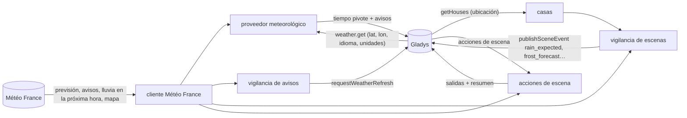
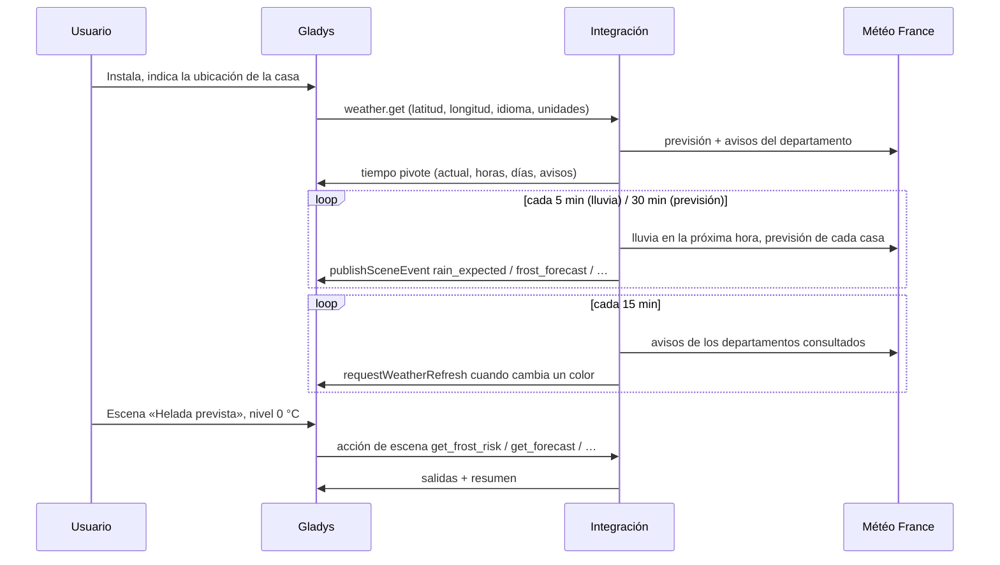
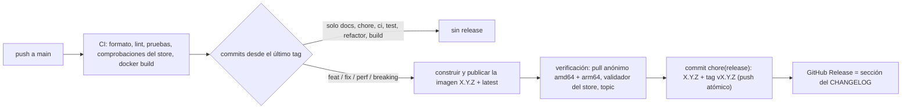

# Gladys Météo France

[English](README.md) · [Français](README.fr.md) · [Deutsch](README.de.md) · **Español**

[](LICENSE)
[](https://github.com/William-De71/gladys-meteo-france/releases)
[](https://github.com/William-De71/gladys-meteo-france/actions/workflows/release.yml)
[](https://gladysassistant.com)


Integración externa de [Gladys Assistant](https://gladysassistant.com) que aporta las previsiones de **Météo
France**, los **avisos** oficiales (vigilance) y **escenas** guiadas por el tiempo para casas situadas en Francia,
construida sobre `@gladysassistant/integration-sdk` 0.15.

**Sin configuración**: previsiones, avisos y escenas pasan por el servicio público de la aplicación móvil de Météo
France. Instale la integración y funciona; una clave de API opcional solo añade el mapa nacional de avisos.

Documentación de usuario: [English](docs/en.md) · [Français](docs/fr.md) · [Deutsch](docs/de.md) ·
[Español](docs/es.md).

> Integración comunitaria, sin vínculo con Météo France ni respaldo de Météo France.

## Contenido

- [Funcionalidades](#funcionalidades)
- [Arquitectura](#arquitectura)
- [Instalación](#instalación)
- [Configuración](#configuración)
- [Desencadenantes de escena](#desencadenantes-de-escena)
- [Acciones de escena](#acciones-de-escena)
- [Ubicación de las casas](#ubicación-de-las-casas)
- [Llamadas a Météo France](#llamadas-a-météo-france)
- [Desarrollo](#desarrollo)
- [Release y convención de commits](#release-y-convención-de-commits)
- [Solución de problemas](#solución-de-problemas)
- [Contribuir](#contribuir)
- [Licencia](#licencia)

## Funcionalidades

**Proveedor meteorológico** (manifiesto `type: "weather"`): sin dispositivos ni pantallas de descubrimiento. Gladys
le pide el tiempo de una casa, y él alimenta el **widget del tiempo** del panel, el **asistente de chat** y los
**desencadenantes de alerta meteorológica** del núcleo. Una vez instalado, toma el relevo de OpenWeather
automáticamente.

- **Previsión por horas** (próximas 24 horas): temperatura, sensación térmica, humedad, presión, nubosidad, viento
  (velocidad, rachas, dirección), precipitación y probabilidad de precipitación.
- **Previsión diaria** (hasta 8 días): temperaturas mínima y máxima, estado del cielo, precipitación y
  probabilidad, viento y rachas, índice UV, salida y puesta del sol. El icono de un día resume sus **horas** (un
  chubasco prevalece sobre un rato de sol), no la instantánea de mediodía que Météo France también publica.
- **Unidades**: métricas o US, según pida Gladys; Météo France solo responde en métrico y la integración convierte.

**Avisos**:

- **Avisos oficiales**: los nueve fenómenos de Météo France, convertidos a las gravedades CAP de Gladys (amarillo →
  moderada, naranja → grave, rojo → extrema), con el nombre del departamento y el boletín oficial completo.
- **Escenas de alerta rápidas**: la integración consulta los avisos cada 15 minutos y avisa a Gladys en cuanto
  cambian, de modo que una escena «Alerta meteorológica activada» se ejecuta en segundos en lugar de esperar a la
  comprobación del núcleo, cada 30 minutos.
- **Mapa de avisos** (opcional, clave de API): el mapa nacional de hoy y mañana, mostrado en el widget.

**Escenas**: nueve desencadenantes (lluvia en la próxima hora, helada, calor, viento, hielo, nieve, tormenta, UV) y
siete acciones de solo lectura, con un resumen listo para enviar en **español, inglés, francés o alemán**, el
idioma de Gladys.

**Transporte**: solo `cloud`. Météo France es un servicio de Internet: no hay nada que alcanzar en la red local, y
la integración nunca cambia de transporte.

## Arquitectura




De la instalación a una escena:



Una integración meteorológica no tiene dispositivos: ni descubrimiento, ni estados, ni consulta por el núcleo.

## Instalación

Desde Gladys (5.1.0 o posterior): **Integraciones → store → Météo France → Instalar**, y acepte el acceso a la
ubicación (los desencadenantes de escena necesitan la posición de las casas). Indique la ubicación de cada casa
(**Ajustes → Viviendas**). Gladys usa entonces Météo France como proveedor meteorológico para las casas situadas en
Francia, y pasa al siguiente proveedor en otros lugares. Vea la [documentación de usuario](docs/es.md).

Imagen Docker: `ghcr.io/william-de71/gladys-meteo-france`, multiarquitectura (amd64/arm64), sin root, sistema de
archivos de solo lectura, etiquetas OCI.

## Configuración

Nada es obligatorio. La pantalla de configuración ofrece dos campos opcionales:

| Clave            | Tipo   | Por defecto | Función                                                            |
| ---------------- | ------ | ----------- | ------------------------------------------------------------------ |
| `api_key`        | secret | —           | clave de API de Météo France, solo para el mapa nacional de avisos |
| `cache_duration` | number | 600         | segundos (0 a 3600) durante los que se reutiliza una respuesta     |

**Clave de API**: solo es necesaria para el mapa nacional de avisos (`public-api.meteofrance.fr` la exige):

1. Cree una cuenta gratuita en el [portal de API de Météo France](https://portail-api.meteofrance.fr/).
2. Suscríbase a la API **Données Publiques de Vigilance** (también listada como _Bulletin Vigilance_,
   `DPVigilance` en las URL técnicas).
3. En la pantalla de configuración de la API, elija el tipo de token **API Key** (**no** OAuth2, cuyo token caduca
   al cabo de una hora aproximadamente) y rellene el campo obligatorio **Durée** **en segundos**: `94672800` (unos
   3 años) es el máximo que acepta el portal.
4. Pegue la clave generada en la pantalla Configuración de la integración. El cliente la envía en la cabecera
   `apikey`.

El mapa deja de mostrarse sin aviso cuando vence ese plazo: anote la fecha de caducidad. Sin la clave, todo lo demás
sigue funcionando.

**Duración de la caché**: cada petición meteorológica cuesta dos llamadas a Météo France, y la API de previsiones
puede tardar unos 20 s en frío, así que se reutiliza una respuesta reciente. Météo France solo actualiza unas pocas
veces por hora: subir a 1800 apenas resta actualidad. Un cambio de aviso vacía la caché y avisa al núcleo sea cual
sea el valor; 0 desactiva la caché (panel más lento).

## Desencadenantes de escena

| Desencadenante (clave)                     | Se activa cuando                                                                                     | Filtros             |
| ------------------------------------------ | ---------------------------------------------------------------------------------------------------- | ------------------- |
| **Lluvia inminente** `rain_expected`       | la previsión radar anuncia lluvia en la próxima hora, cuando antes no la anunciaba                   | casa, intensidad    |
| **Fin de la lluvia** `rain_stopped`        | la lluvia en curso cesa                                                                              | casa                |
| **Helada prevista** `frost_forecast`       | las próximas 24 horas alcanzan 0 °C, -5 °C o un umbral personalizado (-20 a 5 °C)                    | casa, nivel, umbral |
| **Calor intenso previsto** `heat_forecast` | las próximas 24 horas alcanzan 30 °C, 35 °C o un umbral personalizado (20 a 45 °C)                   | casa, nivel, umbral |
| **Viento fuerte previsto** `wind_forecast` | las rachas de las próximas 24 horas alcanzan 60, 80, 100 km/h o un umbral (20 a 150 km/h, de 5 en 5) | casa, nivel, umbral |
| **Hielo previsto** `ice_forecast`          | las próximas 24 horas alcanzan el nivel riesgo / probable de hielo (ver `src/ice.js`)                | casa, nivel         |
| **Nieve prevista** `snow_forecast`         | la nieve o el aguanieve aparece en las próximas 24 horas (presencia, nunca cantidad)                 | casa                |
| **Tormenta prevista** `storm_forecast`     | una tormenta o granizo aparece en las próximas 12 horas                                              | casa                |
| **UV alto previsto** `uv_forecast`         | el índice UV del día siguiente alcanza 6, 8, 11 o un umbral personalizado (1 a 11)                   | casa, nivel, umbral |

Cada desencadenante lleva un `summary` listo para enviar («Lluvia moderada prevista en 20 min.», «Helada prevista:
-2 °C mañana a las 06:00.») y sus cifras como variables de escena: `{{triggerEvent.data.minutes_until_rain}}`,
`temperature_min`, `time`, `hours_until`…

Ejemplo: **Helada prevista**, nivel `0 °C o menos`, casa `Casa` → mensaje «{{triggerEvent.data.summary}} Entre las
plantas.» → «Helada prevista: -2 °C mañana a las 06:00. Entre las plantas.»

Un desencadenante es una **transición**, publicada una vez, nunca un estado reenviado en cada consulta:

- la helada y el calor se activan una vez al día y por umbral: la noche más fría (de mediodía a mediodía) o el día
  más caluroso (de medianoche a medianoche) que entra en las próximas 24 horas, normalmente la víspera; un umbral
  suave puede seguir alcanzado durante semanas, y una ola de calor cierra las persianas cada día;
- el viento se activa una vez por episodio, y solo vuelve a armarse cuando la previsión baja con margen (15 km/h),
  para que unas rachas que rondan un umbral no lo activen cada hora;
- el núcleo solo compara igualdades, así que un umbral personalizado es un evento aparte: los desencadenantes de
  previsión vigilan cada grado (cada 5 km/h para el viento) y publican, por umbral superado, un evento
  `level: "custom"` con `threshold` (siempre en °C / km/h), precedido del evento de nivel fijo cuando coincide con
  ese umbral;
- un desencadenante de lluvia nunca se repite en 30 minutos para una casa, ya que el radar parpadea en el borde de
  un chubasco;
- hielo, nieve y tormenta añaden una espera de 6 horas por desencadenante y nivel, y `uv_forecast` se activa una
  vez al día y por umbral, leyendo el índice de hoy antes de mediodía y el de mañana después;
- la primera consulta tras un arranque sirve de **referencia** y no activa nada, como la propia comprobación de
  alertas meteorológicas del núcleo.

`probability_forecast[].freezing` de Météo France es la probabilidad de una temperatura bajo 0 °C, no de hielo:
`get_ice_risk` e `ice_forecast` buscan en su lugar agua sobre una superficie fría (lluvia helada, lluvia a
T ≤ 0 °C, o lluvia en las 6 horas anteriores a T ≤ -1 °C → probable; superficie mojada a T ≤ 1 °C → riesgo). El
viento de Météo France está en m/s (se pasa tal cual al formato pivote en métrico y se convierte a km/h para las
escenas).

## Acciones de escena

| Acción (clave)                                                    | Salidas principales                                                                                          |
| ----------------------------------------------------------------- | ------------------------------------------------------------------------------------------------------------ |
| **Obtener la previsión de un día** `get_forecast`                 | temperaturas mín./máx., cielo, lluvia y probabilidad, viento, rachas, UV, horas del sol                      |
| **Obtener la lluvia de las próximas horas** `get_rain_next_hours` | `dry`, precipitación total, horas de lluvia, hora de la primera lluvia (1 a 24 h)                            |
| **Obtener la lluvia en la próxima hora** `get_rain_next_hour`     | `available`, `raining`, `rain_expected`, intensidad, minutos hasta la lluvia / hasta que pare                |
| **Obtener los avisos** `get_vigilance`                            | color y nivel, fenómenos, departamento, resumen oficial, boletín completo                                    |
| **Obtener el riesgo de escarcha** `get_frost_risk`                | `level` 0-2, hora más crítica, temperatura, puntos de rocío y de escarcha, humedad, nubes, viento, `reduced` |
| **Obtener el riesgo de hielo** `get_ice_risk`                     | `level` 0-2, hora de inicio, temperatura, `freezing_rain`, lluvia de las últimas 6 h, `freezing_probability` |
| **Obtener la previsión de una hora** `get_hour_forecast`          | una hora de hoy a pasado mañana: temperatura, sensación, cielo, lluvia, viento, rachas, dirección, nubes     |

Cada acción devuelve también un `summary` de una frase, p. ej. «Mañana: lluvia, de 14 a 21 °C, 4,2 mm de lluvia
(80 %), rachas de hasta 55 km/h.» Una cifra que Météo France no proporciona se omite, nunca se envía como 0: 0 mm
se leería como «seco» en las condiciones siguientes. Las acciones son de solo lectura y nunca activan un
desencadenante: una escena no puede crear un bucle a través de la integración.

`get_frost_risk` (`src/frost.js`) lee las horas brutas de Météo France, no las del formato pivote (redondeadas al
grado), desde ahora hasta las 10:00 de la mañana siguiente: punto de rocío a partir de la temperatura y la humedad
(Magnus), punto de escarcha a partir del punto de rocío, y después el nivel (2: T ≤ 1 y Te ≤ 0, o T ≤ 0 y Te ≤ -2;
1: T ≤ 3 y Te ≤ 0), rebajado un grado con cielo cubierto (≥ 80 %) o viento sostenido (≥ 20 km/h). Prevalece la hora
más crítica.

Los textos de escena siguen el idioma de Gladys (español, inglés, francés o alemán; inglés para cualquier otro) y
las cifras su sistema de unidades, tal como el núcleo los envió en su última petición meteorológica. El resumen y el
boletín oficiales de los avisos se mantienen en francés, tal como los redacta Météo France.

## Ubicación de las casas

Los desencadenantes de escena vigilan el tiempo por su cuenta, lo pida el núcleo o no: el núcleo solo obtiene el
tiempo para un widget, el chat o una escena de alerta meteorológica. Por eso el manifiesto declara
`location: true` (mostrado en la pantalla de instalación) y la integración lee las casas con `getHouses()` en cada
conexión y en cada consulta de previsión.

Una casa sin ubicación no se vigila. El campo «Casa» de las escenas admite un nombre de casa: vacío, los
desencadenantes vigilan todas las casas y las acciones usan la primera con ubicación. El tiempo en sí sigue usando
las coordenadas que el núcleo pasa a `onWeatherGet`.

## Llamadas a Météo France

| Qué                       | Punto de acceso                | Cuándo                                               |
| ------------------------- | ------------------------------ | ---------------------------------------------------- |
| Previsión                 | `webservice…/forecast`         | con la caché vacía, y cada 30 min por casa (escenas) |
| Avisos                    | `webservice…/v3/warning/full`  | con cada previsión, y cada 15 min por departamento   |
| Lluvia en la próxima hora | `webservice…/rain`             | cada 5 min por casa cubierta, y en cada acción       |
| Mapa de avisos            | `public-api…/DPVigilance/v1/…` | cuando el widget lo muestra (solo con clave de API)  |

Una casa fuera de la cobertura de la lluvia en la próxima hora (algunas zonas de montaña, ultramar) solo se vuelve a
comprobar cada 6 horas. Météo France cubre **Francia y sus departamentos de ultramar**: para una ubicación fuera de
esa zona, la API de previsiones no devuelve nada utilizable y Gladys pasa a otro proveedor meteorológico
configurado.

## Desarrollo

```bash
npm install
npm test               # pruebas unitarias (node --test), sin red
npm run lint           # ESLint
npm run format:check   # Prettier, como la CI
npx github:GladysAssistant/integration-store . --skip-image-check   # comprobaciones del store
docker build -t gladys-meteo-france:dev .
```

Cada pieza se prueba sin red: las llamadas HTTP viven en un solo módulo, y el resto son funciones puras o fábricas
que reciben sus dependencias como argumentos. Organización: vea [CLAUDE.md](CLAUDE.md).

- `test/structure.test.js` compara las claves de configuración, de los desencadenantes y de las acciones de escena,
  sus valores de opción, variables y salidas, y las claves de los datos de evento con
  `test/fixtures/discovery.baseline.json`, generado a partir de la versión 1.4.1: una clave publicada nunca se
  renombra, ya que todas las escenas que la usan dejarían de funcionar.
- `test/manifest.test.js` mantiene alineados el manifiesto y el código (claves de escena, niveles, intensidades,
  límites).
- `test/i18n.test.js` comprueba los cuatro idiomas del manifiesto, de los textos de escena, de la documentación y de
  los README.
- `test/release.test.js` cubre el script de release (versiones, changelog, actualización de versiones).

Requisitos: Gladys `>= 5.1.0` (desencadenantes y acciones de escena declarados por una integración),
Node.js `>= 22`.

## Release y convención de commits

Las releases son automáticas. Cada push a `main` ejecuta el workflow Release:



- Los commits y los títulos de PR siguen [Conventional Commits](https://www.conventionalcommits.org/), en inglés,
  escritos para el usuario: se convierten en las líneas del changelog. `feat` → minor, `fix` / `perf` → patch, `!`
  o `BREAKING CHANGE:` → major.
- `CHANGELOG.md` se genera en la release: nunca lo edite a mano.
- La imagen se publica y se verifica **antes** de que el manifiesto en `main` anuncie la nueva versión.
- Ejecución manual (Actions → Release → Run workflow): `release-as` fuerza una versión, `dry-run` solo muestra la
  versión y las notas.
- Una rama `main` protegida rechazaría el commit de release: permita que GitHub Actions omita la regla, o use el
  token de una GitHub App.

## Solución de problemas

| Síntoma                                              | Causa probable                                                                              |
| ---------------------------------------------------- | ------------------------------------------------------------------------------------------- |
| Error «No house of Gladys has a location»            | indique la ubicación de una casa en Ajustes → Viviendas                                     |
| Una escena filtrada por casa nunca se activa         | el campo Casa debe coincidir exactamente con el nombre de la casa                           |
| No se activó nada justo tras un reinicio             | la primera comprobación tras un arranque sirve de referencia, a propósito                   |
| Los desencadenantes de lluvia nunca se activan       | la previsión radar no cubre la casa: compruébelo con _Obtener la lluvia en la próxima hora_ |
| Textos de escena en un idioma o unidad equivocados   | siguen la última petición meteorológica de Gladys: muestre una vez el widget del tiempo     |
| El mapa de avisos desaparece al cabo de una hora     | se usó un token OAuth2: genere en su lugar una **API Key**                                  |
| El mapa de avisos desaparece al cabo de varios meses | la duración de la clave ha vencido: genere una clave nueva y péguela en la Configuración    |

Registros detallados: añada la variable de entorno `DEBUG=gladys-integration-sdk` al contenedor.

## Contribuir

Las issues y pull requests son bienvenidas: informes de errores con la versión de Gladys, la versión de la
integración, el municipio de la casa y los registros ([plantillas de issue](.github/ISSUE_TEMPLATE)). También se
agradecen comentarios en el [hilo del foro de Gladys](https://community.gladysassistant.com/t/integration-externe-meteo-france/10322).
Problemas de seguridad: vea [SECURITY.md](SECURITY.md).

## Licencia

[Apache-2.0](LICENSE): vea [NOTICE](NOTICE). Las previsiones, los avisos y los mapas proceden de Météo France.
