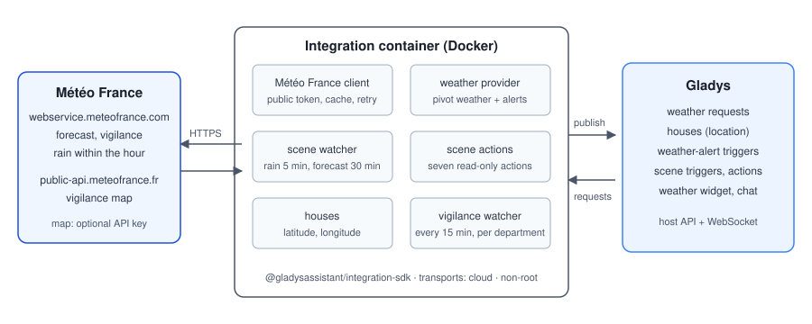
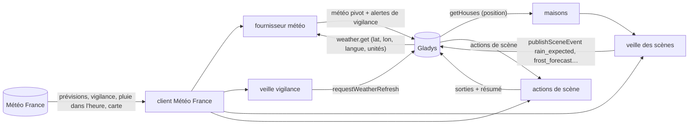
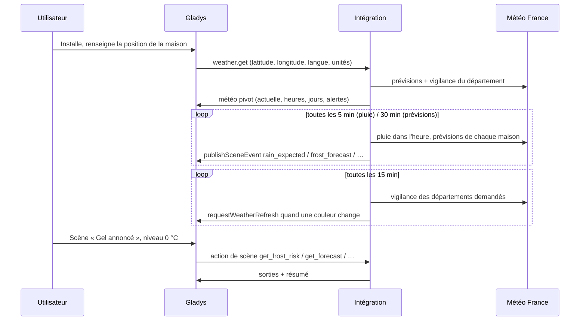
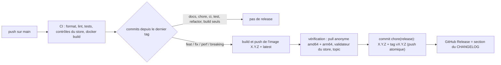

# Gladys Météo France

[English](README.md) · **Français** · [Deutsch](README.de.md) · [Español](README.es.md)

[](LICENSE)
[](https://github.com/William-De71/gladys-meteo-france/releases)
[](https://github.com/William-De71/gladys-meteo-france/actions/workflows/release.yml)
[](https://gladysassistant.com)


Intégration externe de [Gladys Assistant](https://gladysassistant.com) qui apporte les prévisions **Météo
France**, la **vigilance** officielle et des **scènes** pilotées par la météo pour les maisons situées en France,
construite sur `@gladysassistant/integration-sdk` 0.15.

**Aucune configuration** : prévisions, vigilance et scènes passent par le service public de l'application mobile
Météo France. Installez l'intégration et elle fonctionne ; une clé d'API optionnelle ajoute seulement la carte de
vigilance nationale.

Documentation utilisateur : [English](docs/en.md) · [Français](docs/fr.md) · [Deutsch](docs/de.md) ·
[Español](docs/es.md).

> Intégration communautaire, ni affiliée à Météo France ni approuvée par Météo France.

## Sommaire

- [Fonctionnalités](#fonctionnalités)
- [Architecture](#architecture)
- [Installation](#installation)
- [Configuration](#configuration)
- [Déclencheurs de scène](#déclencheurs-de-scène)
- [Actions de scène](#actions-de-scène)
- [Position des maisons](#position-des-maisons)
- [Appels à Météo France](#appels-à-météo-france)
- [Développement](#développement)
- [Release et convention de commits](#release-et-convention-de-commits)
- [Dépannage](#dépannage)
- [Contribuer](#contribuer)
- [Licence](#licence)

## Fonctionnalités

**Fournisseur météo** (manifeste `type: "weather"`) : pas d'appareils, pas d'écran de découverte. Gladys lui
demande la météo d'une maison, et il alimente le **widget météo** du tableau de bord, l'**assistant de chat** et
les **déclencheurs d'alerte météo** du cœur. Une fois installé, il prend automatiquement le relais d'OpenWeather.

- **Prévision horaire** (24 prochaines heures) : température, ressenti, humidité, pression, nébulosité, vent
  (vitesse, rafales, direction), précipitations et probabilité de précipitations.
- **Prévision quotidienne** (jusqu'à 8 jours) : températures minimale et maximale, ciel, précipitations et
  probabilité, vent et rafales, indice UV, lever et coucher du soleil. L'icône d'une journée résume ses **heures**
  (une averse l'emporte sur une éclaircie), et non l'instantané de midi que publie aussi Météo France.
- **Unités** : métriques ou US, selon la demande de Gladys — Météo France ne répond qu'en métrique, l'intégration
  convertit.

**Vigilance** :

- **Alertes officielles** : les neuf phénomènes Météo France, convertis vers les gravités CAP de Gladys (jaune →
  modérée, orange → sévère, rouge → extrême), avec le nom du département et le bulletin officiel complet.
- **Scènes d'alerte rapides** : l'intégration interroge la vigilance toutes les 15 minutes et prévient Gladys dès
  qu'elle change, si bien qu'une scène « Alerte météo déclenchée » part en quelques secondes au lieu d'attendre la
  vérification du cœur, toutes les 30 minutes.
- **Carte de vigilance** (optionnelle, clé d'API) : la carte nationale du jour et du lendemain, affichée dans le
  widget.

**Scènes** : dix déclencheurs (pluie dans l'heure, gel, chaleur, vent, verglas, neige, orage, UV, avalanche) et huit actions
en lecture seule, avec un résumé prêt à envoyer en **français, anglais, allemand ou espagnol**, la langue de
Gladys.

**Transport** : `cloud` uniquement. Météo France est un service Internet : il n'y a rien à joindre sur le réseau
local, et l'intégration ne change jamais de transport.

## Architecture





De l'installation à une scène :



Une intégration météo n'a pas d'appareils : pas de découverte, pas d'états, pas d'interrogation par le cœur.

## Installation

Depuis Gladys (5.1.0 ou plus récent) : **Intégrations → store → Météo France → Installer**, et acceptez l'accès à
la position (les déclencheurs de scène ont besoin de la position des maisons). Renseignez la position de chaque
maison (**Paramètres → Maisons**). Gladys utilise alors Météo France comme fournisseur météo pour les maisons
situées en France, et passe au fournisseur suivant ailleurs. Voir la [documentation utilisateur](docs/fr.md).

Image Docker : `ghcr.io/william-de71/gladys-meteo-france`, multi-architecture (amd64/arm64), non-root, système de
fichiers en lecture seule, labels OCI.

## Configuration

Rien n'est obligatoire. L'écran de configuration propose deux champs optionnels :

| Clé              | Type   | Défaut | Rôle                                                                           |
| ---------------- | ------ | ------ | ------------------------------------------------------------------------------ |
| `api_key`        | secret | —      | clé d'API Météo France, uniquement pour la carte de vigilance nationale        |
| `cache_duration` | number | 600    | secondes (0 à 3600) pendant lesquelles une réponse est réutilisée avant rappel |

**Clé d'API** — nécessaire uniquement pour la carte de vigilance nationale (`public-api.meteofrance.fr` l'exige) :

1. Créez un compte gratuit sur le [portail API Météo France](https://portail-api.meteofrance.fr/).
2. Souscrivez à l'API **Données Publiques de Vigilance** (aussi listée comme _Bulletin Vigilance_, `DPVigilance`
   dans les URL techniques).
3. Sur l'écran de configuration de l'API, choisissez le type de token **API Key** — **pas** OAuth2, dont le jeton
   expire au bout d'une heure environ — puis renseignez le champ obligatoire **Durée** **en secondes** : `94672800`
   (environ 3 ans) est le maximum accepté par le portail.
4. Collez la clé générée dans l'écran Configuration de l'intégration. Le client l'envoie dans l'en-tête `apikey`.

La carte cesse de s'afficher sans prévenir une fois cette durée écoulée : notez la date d'expiration. Sans la clé,
tout le reste continue de fonctionner.

**Durée du cache** — chaque demande météo coûte deux appels à Météo France, et l'API de prévisions peut mettre
environ 20 s à froid : une réponse récente est donc réutilisée. Météo France ne met à jour que quelques fois par
heure : monter à 1800 ne fait presque rien perdre en fraîcheur. Un changement de vigilance vide le cache et
prévient le cœur quelle que soit la valeur ; 0 désactive le cache (tableau de bord plus lent).

## Déclencheurs de scène

| Déclencheur (clé)                                 | Se déclenche quand                                                                                     | Filtres               |
| ------------------------------------------------- | ------------------------------------------------------------------------------------------------------ | --------------------- |
| **Pluie imminente** `rain_expected`               | la prévision radar annonce de la pluie dans l'heure, alors qu'elle n'en annonçait pas                  | maison, intensité     |
| **Fin de la pluie** `rain_stopped`                | la pluie en cours s'arrête                                                                             | maison                |
| **Gel annoncé** `frost_forecast`                  | les 24 prochaines heures atteignent 0 °C, -5 °C ou un seuil personnalisé (-20 à 5 °C)                  | maison, niveau, seuil |
| **Forte chaleur annoncée** `heat_forecast`        | les 24 prochaines heures atteignent 30 °C, 35 °C ou un seuil personnalisé (20 à 45 °C)                 | maison, niveau, seuil |
| **Vent fort annoncé** `wind_forecast`             | les rafales des 24 prochaines heures atteignent 60, 80, 100 km/h ou un seuil (20 à 150 km/h, pas de 5) | maison, niveau, seuil |
| **Verglas annoncé** `ice_forecast`                | les 24 prochaines heures atteignent le niveau risque / probable de verglas (voir `src/ice.js`)         | maison, niveau        |
| **Neige annoncée** `snow_forecast`                | de la neige ou de la pluie et neige apparaît dans les 24 prochaines heures (présence, jamais quantité) | maison                |
| **Orage annoncé** `storm_forecast`                | un orage ou de la grêle apparaît dans les 12 prochaines heures                                         | maison                |
| **UV élevé annoncé** `uv_forecast`                | l'indice UV du jour à venir atteint 6, 8, 11 ou un seuil personnalisé (1 à 11)                         | maison, niveau, seuil |
| **Risque d'avalanche en hausse** `avalanche_risk` | le bulletin d'avalanche du massif de la maison monte à 2, 3, 4 ou 5 (voir `src/avalanche.js`)          | maison, niveau        |

Chaque déclencheur porte un `summary` prêt à envoyer (« Pluie modérée prévue dans 20 min. », « Gel annoncé : -2 °C
prévus demain à 06:00. ») et ses chiffres en variables de scène : `{{triggerEvent.data.minutes_until_rain}}`,
`temperature_min`, `time`, `hours_until`…

Exemple : **Gel annoncé**, niveau `0 °C ou moins`, maison `Maison` → message « {{triggerEvent.data.summary}}
Rentrez les plantes. » → « Gel annoncé : -2 °C prévus demain à 06:00. Rentrez les plantes. »

Un déclencheur est une **transition**, publiée une fois — jamais un état renvoyé à chaque relevé :

- le gel et la chaleur se déclenchent une fois par jour et par seuil — la nuit la plus froide (de midi à midi) ou la
  journée la plus chaude (de minuit à minuit) qui entre dans les 24 prochaines heures, donc en général la veille :
  un seuil doux peut rester atteint des semaines, et une canicule ferme les volets chaque jour ;
- le vent se déclenche une fois par épisode, et ne se réarme qu'une fois la prévision redescendue avec une marge
  (15 km/h), pour que des rafales qui oscillent autour d'un seuil ne déclenchent pas toutes les heures ;
- le cœur ne compare que des égalités, donc un seuil personnalisé est un événement à part : les déclencheurs de
  prévision surveillent chaque degré (chaque 5 km/h pour le vent) et publient, par seuil franchi, un événement
  `level: "custom"` portant `threshold` (toujours en °C / km/h), précédé de l'événement de niveau fixe quand il
  tombe sur ce seuil ;
- un déclencheur de pluie ne se répète jamais dans les 30 minutes pour une maison, le radar vacillant au bord d'une
  averse ;
- verglas, neige et orage ajoutent un délai de 6 heures par déclencheur et par niveau, et `uv_forecast` se déclenche
  une fois par jour et par seuil, en lisant l'indice du jour avant midi et celui du lendemain après ;
- `avalanche_risk` relit chaque heure le bulletin du massif de chaque maison et se déclenche une fois par niveau quand le risque monte, réarmé quand il redescend ; la fin de saison compte comme 0, si bien que le premier bulletin de novembre se déclenche ;
- le premier relevé après un démarrage sert de **référence** et ne déclenche rien, comme la vérification des
  alertes météo du cœur.

La probabilité `probability_forecast[].freezing` de Météo France est celle d'une température négative, pas du
verglas : `get_ice_risk` et `ice_forecast` cherchent plutôt de l'eau sur une surface froide (pluie verglaçante,
pluie à T ≤ 0 °C, ou pluie dans les 6 heures précédentes à T ≤ -1 °C → probable ; surface mouillée à T ≤ 1 °C →
risque). Le vent de Météo France est en m/s (transmis tel quel au pivot en métrique, converti en km/h pour les
scènes).

## Actions de scène

| Action (clé)                                                     | Principales sorties                                                                                              |
| ---------------------------------------------------------------- | ---------------------------------------------------------------------------------------------------------------- |
| **Obtenir les prévisions d'un jour** `get_forecast`              | températures min/max, ciel, pluie et probabilité, vent, rafales, UV, heures du soleil                            |
| **Obtenir la pluie des prochaines heures** `get_rain_next_hours` | `dry`, cumul de précipitations, heures de pluie, heure de la première pluie (1 à 24 h)                           |
| **Obtenir la pluie dans l'heure** `get_rain_next_hour`           | `available`, `raining`, `rain_expected`, intensité, minutes avant la pluie / la fin                              |
| **Obtenir la vigilance** `get_vigilance`                         | couleur et niveau, phénomènes, département, résumé officiel, bulletin complet                                    |
| **Obtenir le risque de givre** `get_frost_risk`                  | `level` 0-2, heure la plus critique, température, points de rosée et de givre, humidité, nuages, vent, `reduced` |
| **Obtenir le risque de verglas** `get_ice_risk`                  | `level` 0-2, heure de début, température, `freezing_rain`, pluie des 6 dernières heures, `freezing_probability`  |
| **Obtenir la météo d'une heure** `get_hour_forecast`             | une heure d'aujourd'hui au surlendemain : température, ressenti, ciel, pluie, vent, rafales, direction, nuages   |
| **Obtenir le risque d'avalanche** `get_avalanche_risk`           | `has_bulletin`, `risk` 1-5, risques sous et au-dessus de `altitude`, `risk_next_day`, commentaire du bulletin    |

Chaque action renvoie aussi un `summary` d'une phrase, par exemple « Demain : pluie, 14 à 21 °C, 4,2 mm de pluie
(80 %), rafales à 55 km/h. » — en espagnol « Mañana: lluvia, de 14 a 21 °C, 4,2 mm de lluvia (80 %), rachas de
hasta 55 km/h. ». Un chiffre que Météo France ne fournit pas est omis, jamais envoyé à 0 — 0 mm se lirait « sec »
dans les conditions qui suivent. Les actions sont en lecture seule et ne déclenchent jamais de déclencheur : une
scène ne peut pas boucler à travers l'intégration.

`get_avalanche_risk` et `avalanche_risk` (`src/avalanche.js`, `src/massifs.js`) lisent le bulletin d'estimation du risque d'avalanche (BRA, XML) du même service public. Une maison appartient au massif qui la contient, ou au plus proche à moins de 5 km, d'après les contours officiels des 36 massifs (Météo France, Licence Ouverte, simplifiés à ~170 m) ; le champ `massif` de l'action accepte un nom ou un numéro. Hors saison (juin à octobre), Météo France répond un message au lieu du bulletin : `has_bulletin` vaut alors `false`.

`get_frost_risk` (`src/frost.js`) lit les heures brutes de Météo France, pas celles du pivot (arrondies au degré),
de maintenant jusqu'à 10 h le matin suivant : point de rosée à partir de la température et de l'humidité (Magnus),
point de givre à partir du point de rosée, puis le niveau (2 : T ≤ 1 et Tg ≤ 0, ou T ≤ 0 et Tg ≤ -2 ; 1 : T ≤ 3 et
Tg ≤ 0), abaissé d'un cran sous un ciel couvert (≥ 80 %) ou un vent soutenu (≥ 20 km/h). L'heure la plus critique
l'emporte.

Les textes des scènes suivent la langue de Gladys (français, anglais, allemand ou espagnol, anglais pour toute
autre) et les chiffres son système d'unités, tels que le cœur les a envoyés lors de sa dernière demande météo. Le
résumé et le bulletin officiels de la vigilance restent en français, tels que Météo France les rédige.

## Position des maisons

Les déclencheurs de scène surveillent la météo d'eux-mêmes, que le cœur la demande ou non — le cœur ne récupère la
météo que pour un widget, le chat ou une scène d'alerte météo. Le manifeste déclare donc `location: true` (affiché
sur l'écran d'installation) et l'intégration lit les maisons avec `getHouses()` à chaque connexion et à chaque
relevé des prévisions.

Une maison sans position n'est pas surveillée. Le champ « Maison » des scènes prend un nom de maison : vide, les
déclencheurs surveillent toutes les maisons et les actions utilisent la première maison localisée. La météo
elle-même utilise toujours les coordonnées que le cœur passe à `onWeatherGet`.

## Appels à Météo France

| Quoi                 | Point d'accès                  | Quand                                                         |
| -------------------- | ------------------------------ | ------------------------------------------------------------- |
| Prévisions           | `webservice…/forecast`         | quand le cache est vide, et toutes les 30 min par maison      |
| Vigilance            | `webservice…/v3/warning/full`  | avec chaque prévision, et toutes les 15 min par département   |
| Pluie dans l'heure   | `webservice…/rain`             | toutes les 5 min par maison couverte, et à chaque action      |
| Carte de vigilance   | `public-api…/DPVigilance/v1/…` | quand le widget l'affiche (clé d'API uniquement)              |
| Bulletin d'avalanche | `webservice…/v2/report` (BRA)  | toutes les heures par massif d'une maison, et à chaque action |

Une maison hors de la couverture de la pluie dans l'heure (outre-mer) n'est revérifiée
que toutes les 6 heures. Météo France couvre **la France et ses départements d'outre-mer** : pour une position hors
de cette zone, l'API de prévisions ne renvoie rien d'exploitable et Gladys bascule sur un autre fournisseur météo
configuré.

## Développement

```bash
npm install
npm test               # tests unitaires (node --test), sans réseau
npm run lint           # ESLint
npm run format:check   # Prettier, comme la CI
npx github:GladysAssistant/integration-store . --skip-image-check   # contrôles du store
docker build -t gladys-meteo-france:dev .
```

Chaque brique se teste sans réseau : les appels HTTP vivent dans un seul module, le reste est fait de fonctions
pures ou de fabriques qui reçoivent leurs dépendances en arguments. Organisation : voir [CLAUDE.md](CLAUDE.md).

- `test/structure.test.js` compare les clés de configuration, des déclencheurs et des actions de scène, leurs
  valeurs d'options, variables et sorties, et les clés des données d'événement à
  `test/fixtures/discovery.baseline.json`, généré depuis la version 1.4.1 : une clé publiée n'est jamais
  renommée — toutes les scènes qui l'utilisent casseraient.
- `test/manifest.test.js` garde le manifeste et le code alignés (clés de scène, niveaux, intensités, bornes).
- `test/i18n.test.js` vérifie les quatre langues du manifeste, des textes de scène, des docs et des README.
- `test/release.test.js` couvre le script de release (versions, changelog, mise à jour des versions).

Prérequis : Gladys `>= 5.1.0` (déclencheurs et actions de scène déclarés par une intégration), Node.js `>= 22`.

## Release et convention de commits

Les releases sont automatiques. Chaque push sur `main` lance le workflow Release :



- Les commits et les titres de PR suivent [Conventional Commits](https://www.conventionalcommits.org/), en anglais,
  écrits pour l'utilisateur : ils deviennent les lignes du changelog. `feat` → mineure, `fix` / `perf` → correctif,
  `!` ou `BREAKING CHANGE:` → majeure.
- `CHANGELOG.md` est généré à la release : ne jamais l'éditer à la main.
- L'image est publiée et vérifiée **avant** que le manifeste sur `main` annonce la nouvelle version.
- Lancement manuel (Actions → Release → Run workflow) : `release-as` force une version, `dry-run` affiche seulement
  la version et les notes.
- Une branche `main` protégée refuserait le commit de release : autorisez GitHub Actions à contourner la règle, ou
  utilisez le jeton d'une GitHub App.

## Dépannage

| Symptôme                                                  | Cause probable                                                                               |
| --------------------------------------------------------- | -------------------------------------------------------------------------------------------- |
| Erreur « No house of Gladys has a location »              | renseignez la position d'une maison dans Paramètres → Maisons                                |
| Une scène filtrée sur une maison ne se déclenche jamais   | le champ Maison doit reprendre exactement le nom de la maison                                |
| Rien n'est parti juste après un redémarrage               | le premier relevé après un démarrage sert de référence, volontairement                       |
| Les déclencheurs de pluie ne se lancent jamais            | la prévision radar ne couvre pas la maison : vérifiez avec _Obtenir la pluie dans l'heure_   |
| Textes des scènes dans la mauvaise langue ou unité        | ils suivent la dernière demande météo de Gladys : affichez une fois le widget météo          |
| La carte de vigilance disparaît au bout d'une heure       | un jeton OAuth2 a été utilisé : générez plutôt une **API Key**                               |
| La carte de vigilance disparaît au bout de plusieurs mois | la durée de la clé est écoulée : générez une nouvelle clé et collez-la dans la Configuration |

Logs détaillés : ajoutez la variable d'environnement `DEBUG=gladys-integration-sdk` au conteneur.

## Contribuer

Les issues et pull requests sont les bienvenues : un rapport de bug avec la version de Gladys, la version de
l'intégration, la commune de la maison et les logs ([modèles d'issue](.github/ISSUE_TEMPLATE)). Les retours sont
aussi bienvenus sur le [fil du forum Gladys](https://community.gladysassistant.com/t/integration-externe-meteo-france/10322).
Problème de sécurité : voir [SECURITY.md](SECURITY.md).

## Licence

[Apache-2.0](LICENSE) — voir [NOTICE](NOTICE). Les prévisions, la vigilance et les cartes proviennent de Météo
France.
