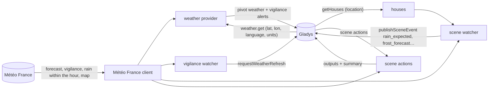
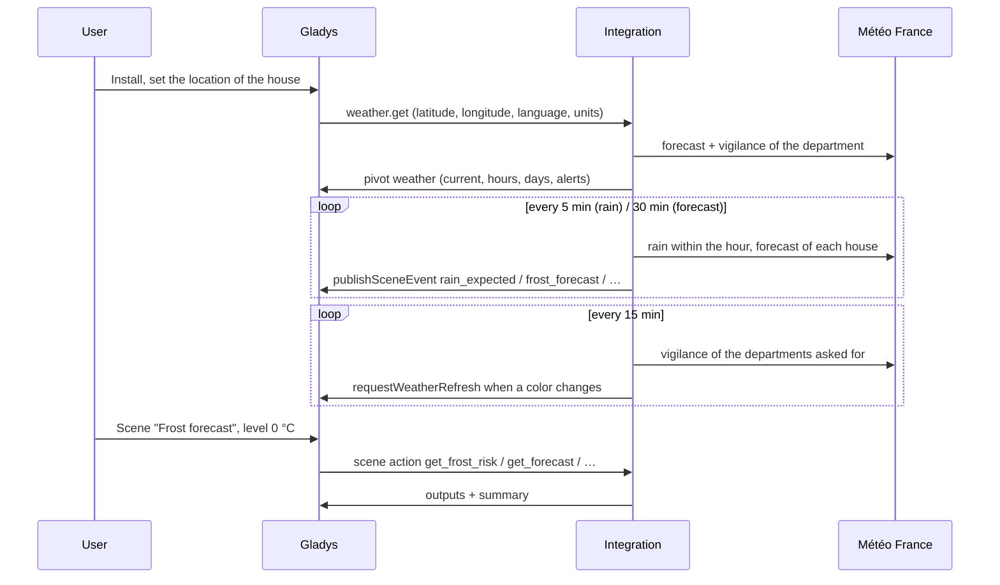
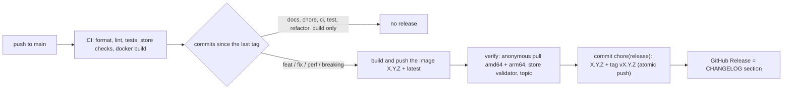

# Gladys Météo France

**English** · [Français](README.fr.md) · [Deutsch](README.de.md) · [Español](README.es.md)

[](LICENSE)
[](https://github.com/William-De71/gladys-meteo-france/releases)
[](https://github.com/William-De71/gladys-meteo-france/actions/workflows/release.yml)
[](https://gladysassistant.com)


External [Gladys Assistant](https://gladysassistant.com) integration providing **Météo France** forecasts, the
official **vigilance** alerts and weather-driven **scenes** for houses in France, built on
`@gladysassistant/integration-sdk` 0.15.

**Zero configuration**: forecasts, vigilance and scenes go through the public service of the Météo France mobile
application. Install the integration and it works; an optional API key only adds the national vigilance map.

User documentation: [English](docs/en.md) · [Français](docs/fr.md) · [Deutsch](docs/de.md) · [Español](docs/es.md).

> Community integration, not affiliated with or endorsed by Météo France.

## Contents

- [Features](#features)
- [Architecture](#architecture)
- [Installation](#installation)
- [Configuration](#configuration)
- [Scene triggers](#scene-triggers)
- [Scene actions](#scene-actions)
- [House location](#house-location)
- [Calls to Météo France](#calls-to-météo-france)
- [Development](#development)
- [Release and commit convention](#release-and-commit-convention)
- [Troubleshooting](#troubleshooting)
- [Contributing](#contributing)
- [License](#license)

## Features

**Weather provider** (manifest `type: "weather"`): no devices, no discovery screens. Gladys asks it for the weather
of a house and it feeds the **dashboard weather widget**, the **chat assistant** and the core's **weather-alert
scene triggers**. When installed, it takes over from OpenWeather automatically.

- **Hourly forecast** (next 24 hours): temperature, feels-like, humidity, pressure, cloud cover, wind
  speed/gust/direction, precipitation and precipitation probability.
- **Daily forecast** (up to 8 days): min/max temperatures, condition, precipitation and probability, wind and
  gusts, UV index, sunrise/sunset. A day's icon summarises its **hours** (a shower beats a sunny spell), not the
  midday snapshot Météo France also publishes.
- **Units**: metric or US, as Gladys asks — Météo France only answers in metric, the integration converts.

**Vigilance**:

- **Official alerts**: the nine Météo France phenomena, mapped to the CAP severities Gladys uses (yellow →
  moderate, orange → severe, red → extreme), with the department name and the full official bulletin.
- **Fast alert scenes**: the integration polls the vigilance every 15 minutes and nudges Gladys the moment it
  changes, so a "Weather alert raised" scene fires in seconds instead of within the core's 30-minute check.
- **Vigilance map** (optional, API key): the national map for today and tomorrow, rendered in the widget.

**Scenes**: ten triggers (rain within the hour, frost, heat, wind, black ice, snow, storm, UV, avalanche) and eight read-only
actions, with a ready-to-send summary in **English, French, German or Spanish**, the language of Gladys.

**Transport**: `cloud` only. Météo France is an Internet service: there is nothing to reach on the local network,
and the integration never switches transport.

## Architecture




From the installation to a scene:



A weather integration has no devices: no discovery, no states, no polling by the core.

## Installation

From Gladys (5.3.0 or later): **Integrations → store → Météo France → Install**, and accept the location access
(the scene triggers need the position of the houses). Set the location of each house (**Settings → Houses**).
Gladys then uses Météo France as its weather provider for the houses in France, and falls through to the next
provider elsewhere. See the [user documentation](docs/en.md).

Docker image: `ghcr.io/william-de71/gladys-meteo-france`, multi-arch (amd64/arm64), non-root, read-only rootfs,
OCI labels.

## Configuration

Nothing is required. The configuration screen offers two optional fields:

| Key              | Type   | Default | Role                                                                   |
| ---------------- | ------ | ------- | ---------------------------------------------------------------------- |
| `api_key`        | secret | —       | Météo France API key, only for the national vigilance map              |
| `cache_duration` | number | 600     | seconds (0 to 3600) a weather answer is reused before calling MF again |

**API key** — only needed for the national vigilance map (`public-api.meteofrance.fr` requires it):

1. Create a free account on the [Météo France API portal](https://portail-api.meteofrance.fr/).
2. Subscribe to the **Données Publiques de Vigilance** API (also listed as _Bulletin Vigilance_, `DPVigilance`
   in technical URLs).
3. On the API configuration screen, pick the **API Key** token type — **not** OAuth2, whose token expires after
   ~1 hour — then fill the mandatory **Durée** field **in seconds**: `94672800` (~3 years) is the maximum the
   portal accepts.
4. Paste the generated key in the integration's Configuration screen. The client sends it as the `apikey` header.

The map silently stops loading once that duration runs out, so keep the expiry date in mind. Without the key,
everything else keeps working.

**Cache duration** — every weather request costs two upstream calls and the forecast endpoint can take ~20 s on a
cold cache, so a recent answer is reused. Météo France only refreshes a few times an hour: raising it to 1800 costs
almost no freshness. A vigilance change clears the cache and nudges the core whatever the value; 0 disables the
cache (slower dashboard).

## Scene triggers

| Trigger (key)                                     | Fires when                                                                                            | Filters                 |
| ------------------------------------------------- | ----------------------------------------------------------------------------------------------------- | ----------------------- |
| **Rain expected within the hour** `rain_expected` | the radar nowcast announces rain within the hour, where it announced none                             | house, intensity        |
| **Rain stopped** `rain_stopped`                   | the rain under way stops                                                                              | house                   |
| **Frost forecast** `frost_forecast`               | the next 24 hours reach 0 °C, -5 °C, or a custom threshold (-20 to 5 °C)                              | house, level, threshold |
| **Heat forecast** `heat_forecast`                 | the next 24 hours reach 30 °C, 35 °C, or a custom threshold (20 to 45 °C)                             | house, level, threshold |
| **Strong wind forecast** `wind_forecast`          | the gusts of the next 24 hours reach 60, 80, 100 km/h, or a custom threshold (20 to 150 km/h, step 5) | house, level, threshold |
| **Black ice forecast** `ice_forecast`             | the next 24 hours reach the black ice risk / likely level (see `src/ice.js`)                          | house, level            |
| **Snow forecast** `snow_forecast`                 | snow or sleet enters the next 24 hours (presence, never an amount)                                    | house                   |
| **Storm forecast** `storm_forecast`               | a thunderstorm or hail enters the next 12 hours                                                       | house                   |
| **High UV forecast** `uv_forecast`                | the daily UV index of the coming day reaches 6, 8, 11 or a custom threshold (1-11)                    | house, level, threshold |
| **Avalanche danger rising** `avalanche_risk`      | the avalanche bulletin of the massif of the house rises to 2, 3, 4 or 5 (see `src/avalanche.js`)      | house, level            |

Every trigger carries a ready-to-send `summary` ("Moderate rain expected in 20 min.", "Frost forecast: -2 °C
expected tomorrow at 06:00.") and its figures as scene variables: `{{triggerEvent.data.minutes_until_rain}}`,
`temperature_min`, `time`, `hours_until`…

Example: **Frost forecast**, level `0 °C or below`, house `Home` → message "{{triggerEvent.data.summary}} Protect
the plants." → "Frost forecast: -2 °C expected tomorrow at 06:00. Protect the plants."

A trigger is a **transition**, published once — never a state re-sent on every poll:

- frost and heat fire once per day and threshold — the coldest night (noon to noon) or the hottest day (midnight to
  midnight) entering the next 24 hours, so usually the day before: a mild threshold can stay reached for weeks, and
  a heatwave closes the shutters every day;
- wind fires once per episode, and re-arms only once the forecast is clear of it by a margin (15 km/h), so gusts
  hovering around a threshold do not fire every hour;
- the core matcher only compares equality, so a custom threshold is an event of its own: the forecast triggers watch
  every degree (every 5 km/h for the wind) and publish, per threshold crossed, a `level: "custom"` event carrying
  `threshold` (always °C / km/h), preceded by the fixed-level event when one sits on that threshold;
- a rain trigger never repeats within 30 minutes for a house, the radar flickering at the edge of a shower;
- ice / snow / storm add a 6-hour cooldown per trigger and level, and `uv_forecast` fires once per day and
  threshold, reading today's daily index before noon and tomorrow's after;
- `avalanche_risk` reads the bulletin of the massif of every house each hour and fires once per level when the danger rises, re-armed when it falls back; the end of the season counts as 0, so the first bulletin of November fires;
- the first poll after a start is a **baseline** and fires nothing, like the core's own weather-alert check.

MF's `probability_forecast[].freezing` is the chance of a temperature below 0 °C, not of black ice:
`get_ice_risk` and `ice_forecast` look for water on a cold surface instead (freezing rain, rain at T ≤ 0 °C, or
rain in the 6 previous hours at T ≤ -1 °C → likely; wet at T ≤ 1 °C → risk). The MF wind is in m/s (passed
through to the pivot for metric, converted to km/h for the scenes).

## Scene actions

| Action (key)                                             | Main outputs                                                                                            |
| -------------------------------------------------------- | ------------------------------------------------------------------------------------------------------- |
| **Get the forecast of a day** `get_forecast`             | min/max temperatures, sky, rain and probability, wind, gusts, UV, sun times                             |
| **Get the rain of the next hours** `get_rain_next_hours` | `dry`, total precipitation, rainy hours, time of the first rain (1-24 h)                                |
| **Get the rain within the hour** `get_rain_next_hour`    | `available`, `raining`, `rain_expected`, intensity, minutes until rain / dry                            |
| **Get the vigilance** `get_vigilance`                    | color and level, phenomena, department, official summary, full bulletin                                 |
| **Get the frost risk** `get_frost_risk`                  | `level` 0-2, worst hour, temperature, dew and frost points, humidity, clouds, wind, `reduced`           |
| **Get the black ice risk** `get_ice_risk`                | `level` 0-2, onset time, temperature, `freezing_rain`, rain of the last 6 h, `freezing_probability`     |
| **Get the forecast of an hour** `get_hour_forecast`      | an hour of today to the day after: temperature, feels like, sky, rain, wind, gusts, direction, clouds   |
| **Get the avalanche danger** `get_avalanche_risk`        | `has_bulletin`, `risk` 1-5, danger below and above `altitude`, `risk_next_day`, comment of the bulletin |

Every action also returns a one-sentence `summary`, e.g. "Tomorrow: rain, 14 to 21 °C, 4.2 mm of rain (80%),
gusts up to 55 km/h." — in German "Morgen: Regen, 14 bis 21 °C, 4,2 mm Regen (80 %), Böen bis 55 km/h.". A figure
Météo France does not provide is left out, never sent as 0 — a 0 mm would read as "dry" in the conditions that
follow. The actions are read-only and never fire a trigger, so a scene cannot loop through the integration.

`get_avalanche_risk` and `avalanche_risk` (`src/avalanche.js`, `src/massifs.js`) read the avalanche bulletin (BRA, XML) of the same public service. A house belongs to the massif containing it, or to the nearest one within 5 km, from the official outlines of the 36 massifs (Météo France, Licence Ouverte, simplified to ~170 m); the `massif` field of the action takes a name or a number. Out of season (June to October), Météo France answers a message instead of the bulletin: `has_bulletin` is then `false`.

`get_frost_risk` (`src/frost.js`) reads the raw MF hours, not the pivot ones (rounded to the degree), from now until
10:00 of the coming morning: dew point from temperature and humidity (Magnus), frost point from the dew point, then
the level (2: T ≤ 1 and Tf ≤ 0, or T ≤ 0 and Tf ≤ -2; 1: T ≤ 3 and Tf ≤ 0), lowered by one under an overcast sky
(≥ 80 %) or a steady wind (≥ 20 km/h). The worst hour wins.

Scene texts follow the language of Gladys (English, French, German or Spanish, English for any other) and the
figures its unit system, as the core sent them in its last weather request. The official vigilance summary and
bulletin stay in French, as Météo France writes them.

## House location

The scene triggers watch the weather on their own, whether or not the core asks for it — the core only pulls the
weather for a widget, the chat or a weather-alert scene. So the manifest declares `location: true` (shown on the
install screen) and the integration reads the houses with `getHouses()` on every connection and forecast poll.

A house without a location is not watched. The scene "House" field takes a house name: left empty, triggers watch
every house and actions use the first located one. The weather path itself still takes the coordinates the core
passes to `onWeatherGet`.

## Calls to Météo France

| What                 | Endpoint                       | When                                                 |
| -------------------- | ------------------------------ | ---------------------------------------------------- |
| Forecast             | `webservice…/forecast`         | on a cache miss, and every 30 min per house (scenes) |
| Vigilance            | `webservice…/v3/warning/full`  | with each forecast, and every 15 min per department  |
| Rain within the hour | `webservice…/rain`             | every 5 min per covered house, and on each action    |
| Vigilance map        | `public-api…/DPVigilance/v1/…` | when the widget shows it (API key only)              |
| Avalanche bulletin   | `webservice…/v2/report` (BRA)  | every hour per massif of a house, and on each action |

A house outside the rain nowcast coverage (overseas) is re-checked only every 6 hours.
Météo France covers **France and its overseas departments**: for a location outside that area, the forecast API
answers with no usable data and Gladys falls back to another configured weather provider.

## Development

```bash
npm install
npm test               # unit tests (node --test), no network
npm run lint           # ESLint
npm run format:check   # Prettier, as the CI runs it
npx github:GladysAssistant/integration-store . --skip-image-check   # store checks
docker build -t gladys-meteo-france:dev .
```

Every piece is testable without a network: the HTTP calls live in one module, the rest are pure functions or
factories taking their dependencies as arguments. Layout: see [CLAUDE.md](CLAUDE.md).

- `test/structure.test.js` compares the configuration, scene trigger and scene action keys, their option values,
  variables and outputs, and the keys of the event data to `test/fixtures/discovery.baseline.json`, generated from
  version 1.4.1: a published key is never renamed — every scene using it would break.
- `test/manifest.test.js` keeps the manifest and the code in step (scene keys, levels, intensities, bounds).
- `test/i18n.test.js` checks the four languages of the manifest, the scene texts, the docs and the READMEs.
- `test/release.test.js` covers the release script (versions, changelog, bump).

Requirements: Gladys `>= 5.3.0` (scene triggers and actions declared by an integration, catalog keywords and countries of Gladys 5.3), Node.js `>= 22`.

## Release and commit convention

Releases are automatic. Every push to `main` runs the Release workflow:



- Commits and PR titles follow [Conventional Commits](https://www.conventionalcommits.org/), in English, written
  for the user: they become the changelog lines. `feat` → minor, `fix` / `perf` → patch, `!` or
  `BREAKING CHANGE:` → major.
- `CHANGELOG.md` is generated at the release: never edit it by hand.
- The image is published and checked **before** the manifest on `main` announces the new version.
- Manual run (Actions → Release → Run workflow): `release-as` forces a version, `dry-run` only shows the version
  and the notes.
- A protected `main` would reject the release commit: allow GitHub Actions to bypass the rule, or use a GitHub
  App token.

## Troubleshooting

| Symptom                                           | Likely cause                                                                     |
| ------------------------------------------------- | -------------------------------------------------------------------------------- |
| "No house of Gladys has a location"               | set the location of a house in Settings → Houses                                 |
| A scene filtered on a house never fires           | the House field must match the house name exactly                                |
| A trigger fired nothing just after a restart      | the first check after a start is a baseline, on purpose                          |
| The rain triggers never fire                      | the radar nowcast does not cover the house: check _Get the rain within the hour_ |
| Scene texts in the wrong language or unit system  | they follow the last weather request of Gladys: display the weather widget once  |
| The vigilance map disappeared after about an hour | an OAuth2 token was used: generate an **API Key** instead                        |
| The vigilance map disappeared after months        | the key duration ran out: generate a new key and paste it in the Configuration   |

Detailed logs: set the environment variable `DEBUG=gladys-integration-sdk` on the container.

## Contributing

Issues and pull requests are welcome: bug reports with the Gladys version, the integration version, the town of the
house and the logs ([issue templates](.github/ISSUE_TEMPLATE)). Feedback on the
[Gladys forum thread](https://community.gladysassistant.com/t/integration-externe-meteo-france/10322) too. Security
problems: see [SECURITY.md](SECURITY.md).

## License

[Apache-2.0](LICENSE) — see [NOTICE](NOTICE). The forecasts, vigilance and maps come from Météo France.
